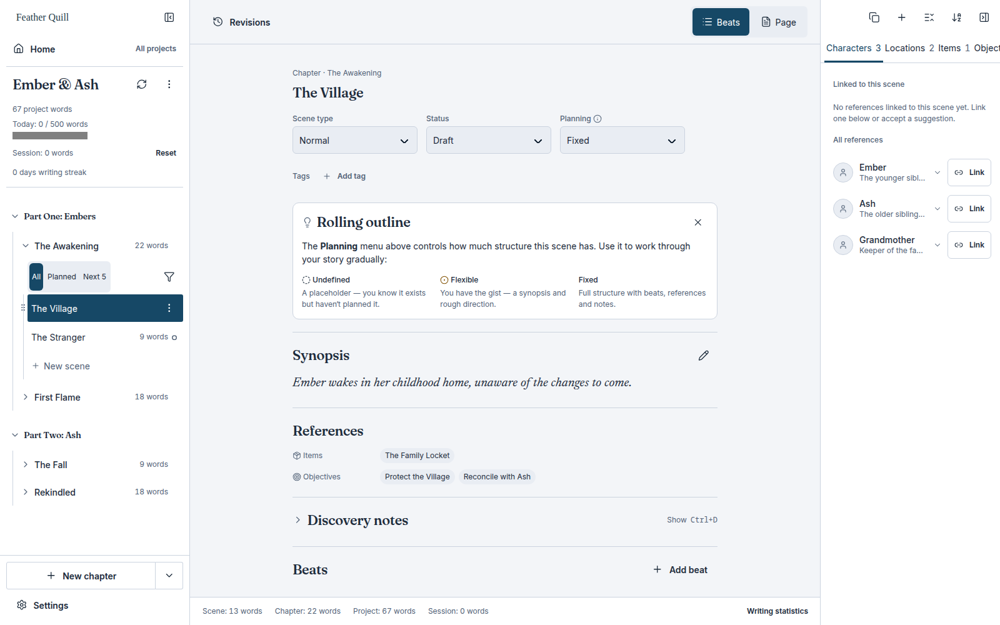

<p align="center">
  
</p>

# Feather Quill

A local writing workspace for ideas, outlines, and manuscripts. Free to use, with no account or subscription required for writing.

Feather Quill is an independent fork of [Kindling](https://github.com/smith-and-web/kindling), created by Josh Smith. Kindling provides the foundation: its Rust/Tauri backend, Svelte interface, manuscript editor, and existing writing and planning tools. This fork keeps those capabilities and takes the application in a direction shaped by how I want to plan and write.

I want somewhere to be messy before I have to be neat. Loose ideas should have room to move around, connect, and develop before becoming an outline or a chapter. Feather Quill's direction is to bring that freeform planning into the same workspace as the manuscript.

**Current status:** this is the initial rebrand of the Kindling fork. The whiteboard and expanded planning features described below are planned; they are not available yet. Existing documentation and screenshots describe the inherited Kindling functionality and may show its original branding.

[Source](https://github.com/DesignForFailure/Feather-Quill) · [Issues](https://github.com/DesignForFailure/Feather-Quill/issues) · [User guides](docs/Home.md) · [Changelog](CHANGELOG.md)

## What is already here

Feather Quill retains Kindling's existing feature set, including:

- Chapters, scenes, beats, outlines, and scaffolded drafting, with page and screenplay editing workflows.
- Reference material for characters, locations, and other story elements.
- Imports from Plottr, Scrivener, yWriter, novelWriter, Longform, and Markdown, with supported source synchronization and reimport workflows.
- Manuscript search and replace, scene revisions, snapshots, writing goals, and statistics.
- Editorial comments, suggestions, review packages, and feedback files that can be exchanged offline.
- Export profiles and formats including DOCX, EPUB, Markdown, plain text, and HTML, plus supported project exchanges.
- Themes, keyboard shortcuts, and the existing localized interface.
- Local SQLite storage and bundled fonts, with no server dependency for writing.

See the [user guides](docs/Home.md) for the details and limitations of each feature.

## Interface



[Dark theme](docs/assets/feather-quill-editor-dark.png) · [Settings](docs/assets/feather-quill-settings-dark.png)

## Where this fork is going

These are product goals, not claims about implemented features.

### Writing and planning

- Simple and fiction writing modes.
- Accessible plain-text formats and expanded Markdown support, building on the existing import and export tools.
- An expanded outliner and a word and phrase frequency analyzer.
- A visual storyline workspace for plots, subplots, and character arcs. Plot points should link directly to manuscript passages, support creation from selected text, and reduce repeated searching and manual entry. Manuscript order and story chronology should be distinct views.

Selected Manuskript workflows are a reference for an independent behavioral specification. No Manuskript source code is included in this rebrand. The intended process separates behavioral research from implementation; it does not assume that a feature name alone establishes a formal clean-room process.

### A whiteboard for a mouse and keyboard

- Preset shapes with editable text inside them.
- Standalone text placed anywhere on the board.
- Freehand mouse drawing and writing.
- Draw-and-hold shape correction: pause at the end of a rough line or shape to turn it into a clean version, with undo and a way to retain the original stroke.
- Zooming, panning, selection, resizing, and connectors.
- Links between planning objects, manuscript scenes, and storylines, so ideas can develop without being repeatedly copied into different tools.

Handwriting-to-text conversion is not currently part of the requested scope.

## Build from source

Prerequisites: Node.js 20+, npm, stable Rust, and the [Tauri platform prerequisites](https://tauri.app/start/prerequisites/).

```bash
git clone https://github.com/DesignForFailure/Feather-Quill.git
cd Feather-Quill
npm ci
npm run tauri dev
```

For a production build:

```bash
npm run tauri build -- -- --no-default-features
```

The default Rust feature includes an upstream debug QA plugin. Production builds exclude it because it has no supplied license. The unused Press mirror and artwork have been removed; the application now uses its own MIT-licensed theme. See [theme provenance](docs/press-replacement.md).

For development against an isolated library, use a scratch directory inside your project workspace:

```bash
FEATHER_QUILL_DATA_DIR="$PWD/qa/demo/data" npm run tauri dev
```

Release builds ignore this override. Feather Quill uses its own application identifier, `io.github.designforfailure.featherquill.app`, and `feather-quill.db`; it does not automatically open or migrate a Kindling installation's library.

## Checks

```bash
npm run check:design-system
npm run check
npm run lint
npm run format:check
npm test
npm run build
npm run test:qa-harness
npm run test:demo-seed
npm run test:rust
npm run format:rust:check
npm run lint:rust
```

Known inherited npm advisories and deprecation findings are recorded in [the dependency review](docs/dependency-review.md). This rebrand does not claim to fix them.

The end-to-end suite is in [e2e/](e2e/README.md). The inherited native visual QA harness currently requires macOS 14+; changing the app's branding does not make the existing screenshot baselines current.

## Updates, feedback, and compatibility

Repository and support links point to this fork. The updater targets this fork's releases, but automatic update checks remain inactive until a fork-owned public signing key is configured. The old Kindling signing key is not reused.

The in-app feedback form is retained, but its backend is unconfigured by default. It must not send feedback to Kindling's service. Use [GitHub issues](https://github.com/DesignForFailure/Feather-Quill/issues) until a Feather Quill endpoint is configured.

Existing `.kindling-review` and `.kindling-feedback` extensions and published interchange identifiers remain for compatibility. They identify file formats, not the application brand. See [fork branding and compatibility](docs/fork-branding.md) for the complete boundary and release setup.

## Contributing

Use this fork's [issue tracker](https://github.com/DesignForFailure/Feather-Quill/issues) and read [CONTRIBUTING.md](CONTRIBUTING.md). Keep the existing writing workflows working as new planning tools are added. Commits follow Conventional Commits.

## Attribution and licensing

Thank you to Josh Smith and the Kindling contributors for the application this fork builds on. Feather Quill is maintained independently by [DesignForFailure](https://github.com/DesignForFailure) and is not an official Kindling release.

The application code is covered by the [MIT license](LICENSE); the original copyright notice is retained. The original Feather Quill branding added by this fork is MIT-licensed; see [its notice](static/feather-quill/LICENSE.txt).

The separately licensed Press mirror, guide, icons, artwork, and inherited rendered snapshots have been removed from the current source tree. Feather Quill uses an independently authored local theme. This is an independent implementation, not a certified clean-room process; see [the replacement record](docs/press-replacement.md).

Inter, Fraunces, and Newsreader retain their separate SIL Open Font License notices in [static/fonts/licenses/](static/fonts/licenses/). Third-party notices are preserved.
